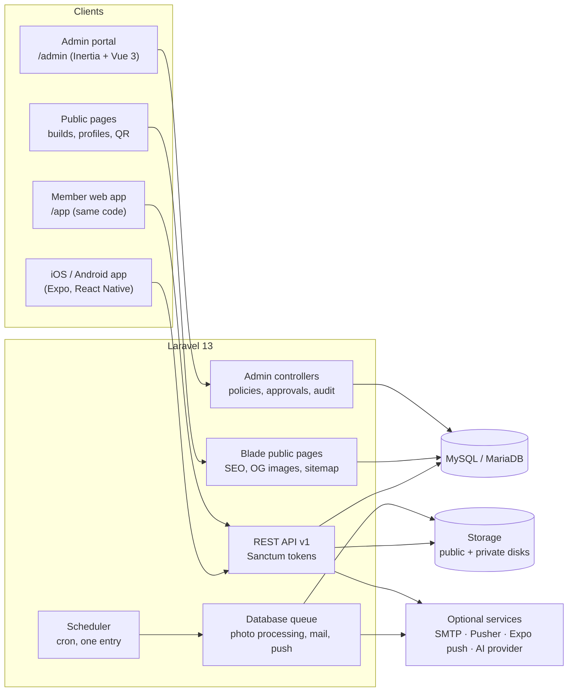

<div align="center">

# SPEED CLUB

**The community platform for car enthusiasts in Germany.**
A digital garage, structured modifications, discovery, messaging and QR stickers that link a real car to its public build page.

[](https://laravel.com)
[](https://www.php.net)
[](https://expo.dev)
[](https://reactnative.dev)
[](https://vuejs.org)
[](https://www.typescriptlang.org)
[](https://tailwindcss.com)
[](https://playwright.dev)

</div>

---

## Contents

- [What it is](#what-it-is)
- [Highlights](#highlights)
- [Architecture](#architecture)
- [Tech stack](#tech-stack)
- [Repository layout](#repository-layout)
- [Getting started](#getting-started)
- [Quality gates](#quality-gates)
- [Security, privacy and compliance](#security-privacy-and-compliance)
- [Deployment](#deployment)
- [Documentation](#documentation)

## What it is

SPEED CLUB gives every car its own page: owners document their build with structured modifications (wheels, suspension, engine, exhaust and more, each with typed fields), follow other builds, discover cars by make, model and setup, and talk to each other. A weatherproof **QR sticker** on the real car opens its public build page, so a car at a meet links straight to its story.

One repository holds three products:

| Product | What it is | Built with |
|---|---|---|
| **Member app** | iOS and Android app, and the same app as a web app at `/app` | Expo + React Native, one codebase |
| **Platform backend** | REST API, public SEO pages for builds and profiles, mail, jobs | Laravel 13 |
| **Admin portal** | The team's "god mode": members, vehicles, catalogue, moderation, support, content, configuration, team and system | Laravel + Inertia + Vue 3 |

The whole platform runs on **standard shared hosting** (PHP + MySQL/MariaDB): no Node, Redis or daemons at runtime.

## Highlights

**For members**
- **Digital garage:** vehicles with photos (re-encoded, EXIF-free, blurhash placeholders), focal points, specs and a structured modification list backed by a versioned catalogue of makes, models, generations, part brands and field schemas.
- **QR stickers:** one code per car, printable and downloadable, with scan statistics and milestones; revoking or reissuing a sticker never breaks the build page.
- **Home and discovery:** a ranked feed with diversity rules, faceted search by make, model, generation and wheel setup, list and grid views, similar builds, collections.
- **Messaging:** requests, conversations with photos and shared vehicles, typing and read states, reactions, realtime through Pusher with a polling fallback.
- **Social graph:** follow, save, block, member profiles and their garages.
- **Safety:** reporting on every surface, blocking, decisions with a statement of reasons, appeals (EU Digital Services Act).
- **Settings:** sessions and devices, two-factor authentication, privacy, notifications with quiet hours, language and units, data export, account deletion, help and support tickets.
- **Optional AI assistance** behind feature flags: natural-language search, description and modification help, photo suggestions, translation. Every suggestion is labelled; the platform works fully without a provider key.

**For the team (admin portal)**
- A separate staff identity with **mandatory TOTP**, recent-password confirmation for sensitive actions, idle timeout and an optional IP allow-list.
- **Four-eyes approvals** for high-risk actions (deletions, exports, suspensions, role changes, large bulk actions), executed only after a second person approves.
- An **append-only audit log with a hash chain**, verified nightly.
- Members, vehicles, photo review and QR codes; read-only **"view as member"** for support.
- Catalogue management with merges, aliases, schema versions and CSV import with a dry run.
- Moderation queues, case pages, decision composer with statement-of-reasons templates, appeals, keyword rules; support tickets with macros.
- Brand, home curation, announcements, legal texts with re-consent, help articles, mail templates, feature flags and remote config: each as a **draft with preview, versions and rollback**.
- Team and roles with a permission matrix, GDPR requests with deadlines, retention settings, system health, jobs, integrations and backups.

## Architecture



- **Thin controllers → FormRequest → Policy → Action → Resource**, enums for every status, ULIDs for user content, transactions around every write.
- **One design system, three renderers:** colours, type, spacing and radii live in `design/tokens/tokens.json` and are generated into the app theme, the admin Tailwind theme and the public CSS, with a WCAG contrast gate.
- **Contract-first API:** the OpenAPI document (`docs/api/openapi.json`) is exported from the backend and turned into typed client code for the app.
- **Shared-hosting friendly:** the queue lives in the database and is worked by the scheduler every minute; on hosts that disable `proc_open`, `speedclub:schedule-inline` runs the same schedule in-process.

## Tech stack

| Area | Technology |
|---|---|
| Mobile and member web | Expo SDK 58, React Native 0.88, React 19, Expo Router, TypeScript (strict), TanStack Query, React Hook Form + Zod, Reanimated 4, React Native Gesture Handler 3, FlashList 2, expo-image, i18next |
| Backend | Laravel 13, PHP 8.3+, Sanctum, Fortify (staff), Scramble (OpenAPI), spatie/laravel-health, spatie/laravel-backup, Laravel AI SDK |
| Admin portal | Inertia 3, Vue 3.5 (`<script setup>`, TypeScript), Reka UI, TanStack Vue Table, Tailwind CSS 4, Phosphor icons, laravel-vue-i18n |
| Data | MySQL 8 / MariaDB 10.6+, database queue, cache and sessions |
| Design | Design tokens with generated themes (Carbon, Black, Light), Inter + Barlow Semi Condensed, custom automotive glyphs on the Phosphor grid |
| Testing | Pest 4, PHPStan level 8 (Larastan), Pint, Jest + React Native Testing Library, Playwright (Chromium + WebKit), axe-core, Lighthouse CI, Maestro flows |
| Delivery | Signed Android builds, EAS profiles for iOS/TestFlight, a deploy package for shared hosting |

## Repository layout

```
speedclub/
├─ mobile/        Expo app: routes in src/app, features in src/features/*, design system in src/ui, theme, API client, i18n
├─ web/           Laravel: API (routes/api/v1), admin (routes/admin, resources/js/admin), public Blade pages, jobs, mail
├─ design/        design tokens and generators, brand files, custom icons, licensed demo photos
├─ docs/          product spec, screen register, design system, architecture, admin spec, QA, legal, decisions, guides
└─ scripts/       verification, Android build, deploy package, local services
```

## Getting started

**Requirements:** PHP 8.3+ with the extensions in `docs/DEPLOY.md` §0, Composer 2, Node 22.13+, MySQL 8 or MariaDB 10.6+. For Android builds: JDK 17 and the Android SDK.

```bash
# 1. Design tokens (generated into the app, the admin and the public CSS)
node design/scripts/build-tokens.mjs

# 2. Backend and admin portal
cd web
composer install
cp .env.example .env          # set DB_* for your local database
php artisan key:generate
php artisan migrate --seed    # catalogue, roles, legal drafts, help, demo data
npm install && npm run build
php artisan serve             # http://localhost:8000

# 3. Member app
cd ../mobile
npm install
npm run web                   # member web in the browser
npx expo start                # iOS / Android via Expo
```

The admin portal lives at `/admin`, the member web app at `/app`, the API under `/api/v1`, and the interactive API reference at `/docs/api`.

## Quality gates

Every module ships only when all gates are green. One command runs a whole phase's gates:

```bash
powershell -File scripts/verify.ps1 -Phase 3     # tokens, icons, mobile, Laravel, performance, assets, audits, export, e2e, visual, Lighthouse
```

| Gate | What runs |
|---|---|
| Mobile | `tsc` (strict), ESLint, about 2,800 Jest tests, i18n key checks |
| Backend | Pint, PHPStan level 8, about 6,500 Pest tests including an authorisation matrix for every endpoint, `composer audit`, performance probes against large data sets |
| Admin and public assets | `vue-tsc`, ESLint, Vite build, `npm audit` |
| End-to-end | about 2,350 Playwright tests in Chromium and WebKit: member flows, admin flows, accessibility (axe) and DOM audits |
| Visual regression | every route in every state (loading, empty, error, offline, restricted), in three themes, German and English, from 360 to 1440 px and at 200 % font: over 5,400 screenshots per run, compared against approved baselines |
| Performance | Lighthouse CI on the public pages |

Further reading: `docs/07_QA_AND_RELEASE.md`.

## Security, privacy and compliance

- Staff and members are completely separate (tables, guards, cookies, password resets); staff never see or set member passwords.
- Rate limits and idempotency keys on every creating request, uploads re-encoded with metadata stripped, private files only through signed, authorised routes.
- GDPR: data export, account deletion, retention periods, privacy requests with deadlines in the admin.
- EU Digital Services Act: notice and action, statements of reasons, internal appeals.
- EU AI Act: every AI suggestion is labelled; AI features are off unless a provider is configured.
- `docs/08_LEGAL_COMPLIANCE.md` lists the obligations and how the product meets them.

## Deployment

The backend, the admin portal and the member web app ship as one package for shared hosting:

```bash
powershell -File scripts/package-web.ps1          # releases/web/speedclub-web-<version>-<stamp>.zip + .sha256
php artisan speedclub:doctor                      # on the host: PHP, extensions, database, cron, storage, HTTPS, mail, backups
```

`docs/DEPLOY.md` walks through the first deploy, cron, storage, staff onboarding, HTTPS, updates, backups and the restore test. Android builds come from `scripts/build-apk.ps1` (`-Target lan | staging | production`); iOS builds use the EAS profiles in `mobile/eas.json` (`docs/IOS_TESTFLIGHT.md`).

## Documentation

| Document | Contents |
|---|---|
| `docs/01_CLIENT_BRIEF.md` | The product brief and scope of version 1 |
| `docs/02_PRODUCT_SPEC.md` | Features, rules and flows |
| `docs/03_DESIGN_SYSTEM.md` | Tokens, components and the flagship screens |
| `docs/04_SCREEN_REGISTER.md` | Every route with its states |
| `docs/05_ARCHITECTURE.md` | System design, data model, API, jobs |
| `docs/06_ADMIN_SPEC.md` | The admin portal, roles and permissions |
| `docs/07_QA_AND_RELEASE.md` | Test strategy, gates and release process |
| `docs/08_LEGAL_COMPLIANCE.md` | GDPR, DSA, AI Act and German law |
| `docs/DECISIONS.md` | About 195 architecture decision records |
| `docs/DEPLOY.md` | Hosting, deploy, updates, backups |
| `docs/ADMIN_GUIDE.md`, `docs/CLIENT_GUIDE.md` | Guides for the team (German) and for the client |
| `docs/STORE_READINESS.md`, `docs/IOS_TESTFLIGHT.md` | Store listings and iOS distribution |
| `docs/RELEASES.md` | Release history |

---

<sub>© 2026 SPEED CLUB. All rights reserved.</sub>
